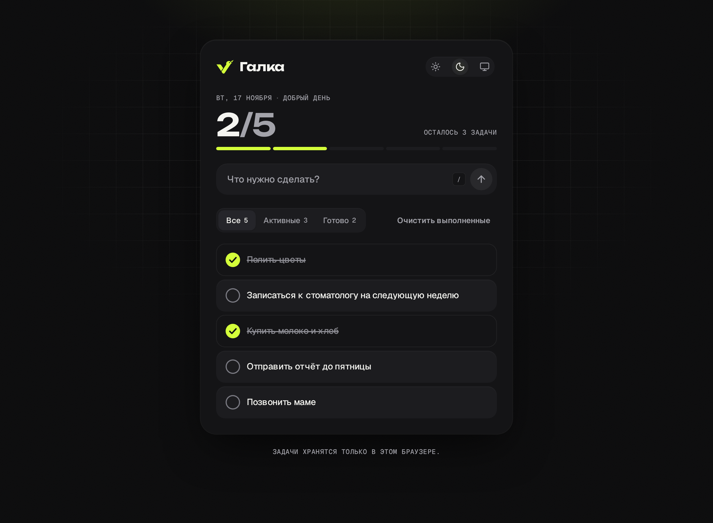
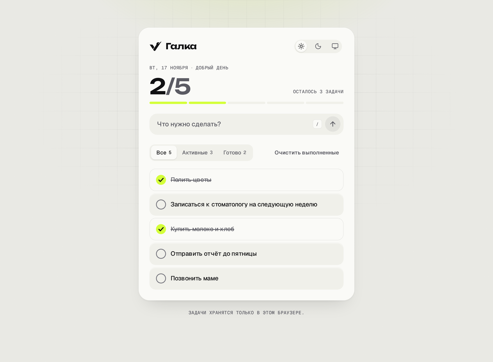

# Галка

Простое to-do приложение: добавляй задачи, отмечай выполненные и забывай. Данные хранятся только в твоём браузере (localStorage), бэкенда нет.

**Демо:** https://galka-todo.vercel.app

| Десктоп, тёмная (по умолчанию) | Десктоп, светлая | Мобильный, тёмная |
|---|---|---|
|  |  |  |

Дизайн «Ночная галка / Acid Ink»: ТЗ и чек-лист приёмки — в [docs/design/BRIEF.md](docs/design/BRIEF.md), знак и варианты лого — в [docs/design/logo/](docs/design/logo/).

## Возможности

- Создание задач по Enter или кнопке «Добавить задачу»; пустой и пробельный ввод игнорируется, лимит 200 символов. Esc очищает поле, «/» фокусирует его из любого места.
- Отметка выполненной и снятие отметки (анимированная галочка), удаление задачи.
- **Прогресс дня:** большой счётчик «выполнено/всего», сегменты (до 12 задач) или полоса, подпись «Осталось 3 задачи» со склонением, при всех выполненных — «Всё сделано» с лаймовым свечением. Доступно как `progressbar`.
- **Undo:** после удаления задачи или «Очистить выполненные» появляется тост «Вернуть» на 5 секунд (пауза при наведении и фокусе); задачи возвращаются на прежние места со статусом.
- Фильтры «Все / Активные / Готово» (radiogroup, стрелки/Home/End), три пустых состояния, «Очистить выполненные».
- **Темы:** тёмная по умолчанию, светлая и «Как в системе», без вспышки при загрузке; выбор запоминается.
- Сохранение в localStorage (ключ `galka:tasks:v1`), устойчивость к битому JSON и недоступному хранилищу; синхронизация между вкладками.
- Адаптивная вёрстка (375px), длинные слова переносятся без горизонтального скролла, хит-зоны ≥ 44px, кнопка удаления видна на touch-устройствах.
- Доступность: нативные чекбоксы, русские `aria-label`, `aria-live` у счётчика и тоста, поддержка `prefers-reduced-motion`.

## Стек

Next.js 16, React 19, TypeScript, Tailwind CSS v4, lucide-react, Vitest (юнит-тесты), Playwright (e2e).

## Запуск

```bash
npm i
npm run dev        # dev-сервер, http://localhost:3000
npm test           # юнит-тесты (Vitest)
npm run test:e2e   # e2e-тесты (Playwright); сам собирает и поднимает приложение на :3517
npm run build      # продакшен-сборка
npm run start      # запуск собранного приложения
```

Перед первым запуском e2e: `npx playwright install chromium`.
Дополнительно: `npm run typecheck`, `npm run lint`.

## Структура

```
src/app/            страница и layout, глобальные стили
src/components/     UI: composer, прогресс дня, список, фильтры, тост undo, переключатель темы
src/lib/tasks/      модель, store, undo, storage, хуки useTasks/useUndo
src/lib/            plural (склонения), theme, утилиты
e2e/                Playwright-сценарии
docs/design/        бриф дизайна и лого
docs/screenshots/   скриншоты для README
```

Подробности архитектуры, краевых случаев и критериев качества — в [ARCHITECTURE.md](ARCHITECTURE.md).
