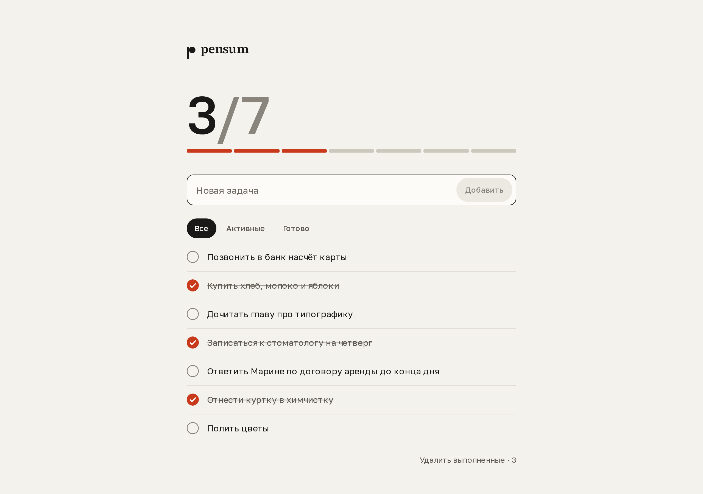
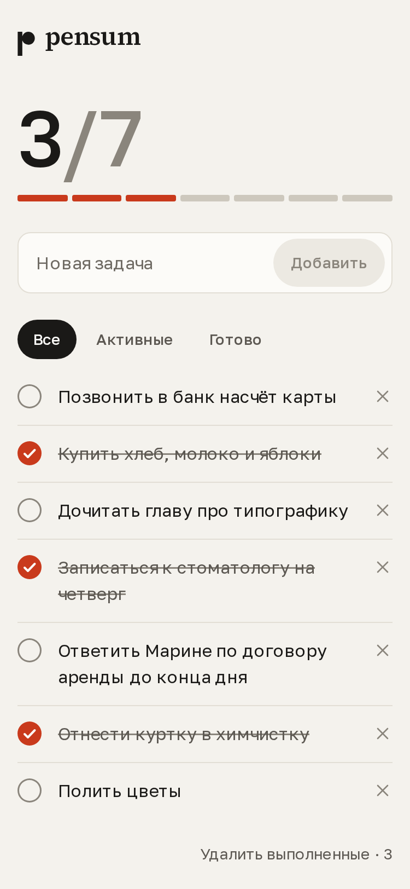
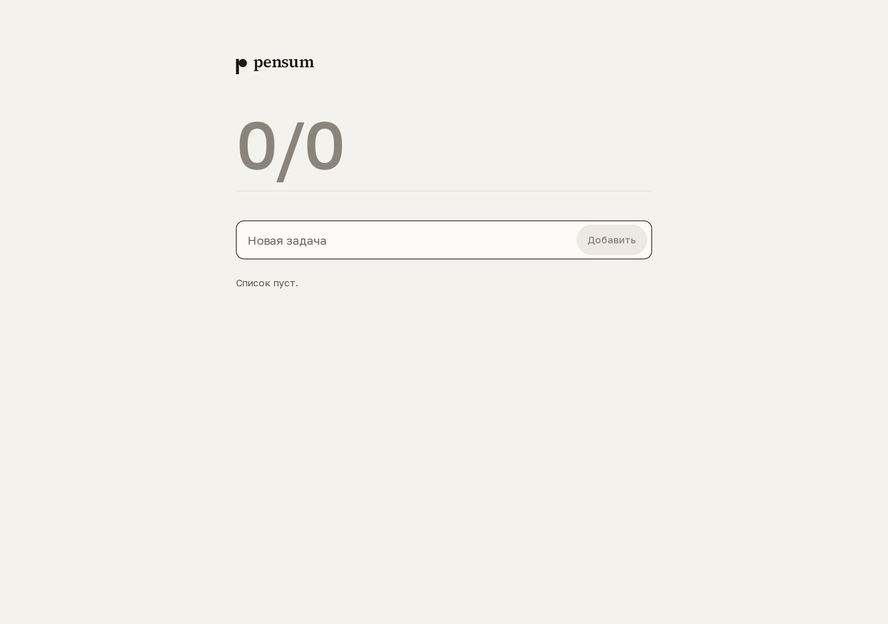

# pensum

Простой список дел: записать задачу, отметить, посчитать. Данные хранятся в localStorage браузера, бэкенда нет.

**Демо:** https://galka-todo.vercel.app

| Десктоп | Мобильный | Пустой список |
|---|---|---|
|  |  |  |

Направление дизайна — «Бумага и чернила»: тёплая бумага, чернильный текст, единственный акцент (киноварь) только для «сделано». Без тем, неона, свечений и декора. ТЗ и чек-лист приёмки — [docs/design/BRIEF-v2.md](docs/design/BRIEF-v2.md), фидбэк заказчика, который стал законом, — [docs/design/FEEDBACK-2.md](docs/design/FEEDBACK-2.md), знак и варианты лого — [docs/design/logo-v2/](docs/design/logo-v2/).

## Возможности

- Создание задач по Enter или кнопке «Добавить»; пустой и пробельный ввод игнорируется, лимит 200 символов. Esc очищает поле, «/» фокусирует его из любого места.
- Отметка выполненной и снятие отметки, удаление задачи.
- **Прогресс:** крупный счётчик «3/7» и сегментный степпер (до 24 задач, дальше полоса); доступен как `status` и `progressbar` «Прогресс дня» с текстом «Выполнено N из M».
- **Undo:** после удаления задачи или «Удалить выполненные» появляется тост «Вернуть» на 5 секунд (пауза при наведении и фокусе); возвращает и кнопка, и **Ctrl+Z** (⌘+Z). Задачи встают на прежние места со статусом.
- **«Удалить выполненные · N»:** при наведении и фокусе подсвечивает строки, которые будут удалены.
- Фильтры «Все / Активные / Готово» (radiogroup, стрелки/Home/End) и пустые состояния.
- Сохранение в localStorage (ключ `galka:tasks:v1`, сохранён намеренно для совместимости), устойчивость к битому JSON и недоступному хранилищу; синхронизация между вкладками.
- Адаптивная вёрстка (375px), длинные слова переносятся без горизонтального скролла, хит-зоны ≥ 44px, кнопка удаления видна на touch-устройствах.
- Доступность: нативные чекбоксы, русские `aria-label`, живые регионы у счётчика и тоста, поддержка `prefers-reduced-motion`.

## Стек

Next.js 16, React 19, TypeScript, Tailwind CSS v4, lucide-react, Vitest (юнит-тесты), Playwright (e2e).

## Запуск

```bash
npm i
npm run dev        # dev-сервер, http://localhost:3000
npm test           # юнит-тесты (Vitest)
npm run test:e2e   # e2e-тесты (Playwright); сам собирает и поднимает приложение на :3517
npm run build      # продакшен-сборка
npm run start      # запуск собранного приложения
```

Перед первым запуском e2e: `npx playwright install chromium`.
Дополнительно: `npm run typecheck`, `npm run lint`.

## Структура

```
src/app/            страница и layout, глобальные стили
src/components/     UI: composer, счётчик и степпер, список, фильтры, тост undo
src/lib/tasks/      модель, store, undo, storage, хуки useTasks/useUndo
src/lib/            бренд, иконки, анимации, утилиты
e2e/                Playwright-сценарии
docs/design/        бриф дизайна, фидбэк и лого
docs/screenshots/   скриншоты для README
```

Подробности архитектуры, краевых случаев и критериев качества — в [ARCHITECTURE.md](ARCHITECTURE.md).
